### 👋 Hey, I'm Liam

AI Solution Architect in London, working where the Microsoft stack meets AI agents. Copilot Studio, Power Platform, Microsoft 365 Copilot and MCP are home turf.

I like agents that actually get things done, Power Apps that don't look like Power Apps, and Copilot bills that don't surprise anyone.

### 🤖 This week, according to my AI

<!-- DEVLOG:START -->
> **Profile README gets a proper glow-up**
>
> - Three commits landed on the profile page: a first README, then an animated makeover with hero banner, live stats, 3D skyline, snake and Connect Four. 🐍
> - The devlog now runs on GitHub Copilot, since GitHub Models was retired, and the stats languages got a tidy-up.
> - Four contributions in total, so a bit of work happened in private repos too. No spoilers, mind. 😉
>
> 7 days to 10 Oct 2026 · written by GitHub Copilot, running in GitHub Actions. It only sees my public activity and has strict orders not to make things up.
<!-- DEVLOG:END -->

### 🛠️ Things I've built

| Project | What it does |
| --- | --- |
| **[Claw PC for Copilot Cowork](https://github.com/ogradyliam5/copilot-cowork-claw-pc)** | Gives Microsoft 365 Copilot Cowork a real Windows machine to work on (a VM or your own PC): commands, PowerShell, files and long-running jobs through a private dev tunnel. One script to start it, one plugin to upload. |
| **[Copilot Studio Credit Estimator](https://github.com/ogradyliam5/copilot-studio-credit-estimator)** [Try it live ↗](https://ogradyliam5.github.io/copilot-studio-credit-estimator/) | Works out what your Copilot Studio agents will cost: Standard harness vs GitHub Copilot harness, side by side. Spoiler: they're not priced the same. Not even close. |
| **[Vercel MCP server for Copilot Studio](https://github.com/ogradyliam5/vercel-mcp-copilot-studio)** | Zero-dependency MCP server (Streamable HTTP, API key auth) that lets a Copilot Studio agent inspect Vercel projects and deployments, read build logs and run management actions. |
| **[Hevy for ChatGPT](https://github.com/ogradyliam5/hevy-chatgpt-plugin)** | Unofficial Hevy integration for ChatGPT and Codex: analyse training, plan routines and safely log workouts through OAuth-enabled MCP tools. |
| **[Auto Flight Check-In](https://github.com/ogradyliam5/auto-flight-checkin)** | Spots airline booking confirmations in your inbox, extracts the flight with an LLM, then sends an AI browser agent to check you in as soon as check-in opens. Any airline. |

### 🎮 Think you can beat my bot?

<!-- CONNECT4:START -->

**Game #1** · 6 moves in · you're 🔵, my bot is 🟡

| [1️⃣](https://github.com/ogradyliam5/ogradyliam5/issues/new?title=connect4%7Cdrop%7C1&body=Just%20hit%20Create.%20You%20don't%20need%20to%20type%20anything.%0A%0AMy%20bot%20replies%20in%20about%20a%20minute.%20Then%20head%20back%20to%20the%20profile%20to%20see%20the%20board.) | [2️⃣](https://github.com/ogradyliam5/ogradyliam5/issues/new?title=connect4%7Cdrop%7C2&body=Just%20hit%20Create.%20You%20don't%20need%20to%20type%20anything.%0A%0AMy%20bot%20replies%20in%20about%20a%20minute.%20Then%20head%20back%20to%20the%20profile%20to%20see%20the%20board.) | [3️⃣](https://github.com/ogradyliam5/ogradyliam5/issues/new?title=connect4%7Cdrop%7C3&body=Just%20hit%20Create.%20You%20don't%20need%20to%20type%20anything.%0A%0AMy%20bot%20replies%20in%20about%20a%20minute.%20Then%20head%20back%20to%20the%20profile%20to%20see%20the%20board.) | [4️⃣](https://github.com/ogradyliam5/ogradyliam5/issues/new?title=connect4%7Cdrop%7C4&body=Just%20hit%20Create.%20You%20don't%20need%20to%20type%20anything.%0A%0AMy%20bot%20replies%20in%20about%20a%20minute.%20Then%20head%20back%20to%20the%20profile%20to%20see%20the%20board.) | [5️⃣](https://github.com/ogradyliam5/ogradyliam5/issues/new?title=connect4%7Cdrop%7C5&body=Just%20hit%20Create.%20You%20don't%20need%20to%20type%20anything.%0A%0AMy%20bot%20replies%20in%20about%20a%20minute.%20Then%20head%20back%20to%20the%20profile%20to%20see%20the%20board.) | [6️⃣](https://github.com/ogradyliam5/ogradyliam5/issues/new?title=connect4%7Cdrop%7C6&body=Just%20hit%20Create.%20You%20don't%20need%20to%20type%20anything.%0A%0AMy%20bot%20replies%20in%20about%20a%20minute.%20Then%20head%20back%20to%20the%20profile%20to%20see%20the%20board.) | [7️⃣](https://github.com/ogradyliam5/ogradyliam5/issues/new?title=connect4%7Cdrop%7C7&body=Just%20hit%20Create.%20You%20don't%20need%20to%20type%20anything.%0A%0AMy%20bot%20replies%20in%20about%20a%20minute.%20Then%20head%20back%20to%20the%20profile%20to%20see%20the%20board.) |
|:-:|:-:|:-:|:-:|:-:|:-:|:-:|
| ⚪ | ⚪ | ⚪ | ⚪ | ⚪ | ⚪ | ⚪ |
| ⚪ | ⚪ | ⚪ | ⚪ | ⚪ | ⚪ | ⚪ |
| ⚪ | ⚪ | ⚪ | ⚪ | ⚪ | ⚪ | ⚪ |
| ⚪ | ⚪ | 🔵 | ⚪ | ⚪ | ⚪ | ⚪ |
| ⚪ | ⚪ | 🟡 | ⚪ | ⚪ | ⚪ | ⚪ |
| ⚪ | 🟡 | 🔵 | 🔵 | 🟡 | ⚪ | ⚪ |

**Click a number to drop your counter.** It opens an issue: hit **Create** and my bot replies in about a minute.

👥 Humans **0** · 🤖 Bot **0** · 🤝 Draws **0**

Latest: [@ogradyliam5](https://github.com/ogradyliam5) → 3, 🤖 → 5 · [@ogradyliam5](https://github.com/ogradyliam5) → 3, 🤖 → 3 · [@ogradyliam5](https://github.com/ogradyliam5) → 4, 🤖 → 2

<!-- CONNECT4:END -->

<b>How does this work?</b>

 

Each number opens a pre-filled GitHub issue. When you hit **Create**, a GitHub Actions workflow drops your 🔵 counter, a little minimax bot picks its 🟡 reply, the issue gets a reply and closes itself, and this README is rewritten with the new board. It's one community game: everyone plays 🔵 together against the bot.

### 📊 By the numbers

My last 12 months of commits as a 3D city, rebuilt every night…

<picture>
  <source media="(prefers-color-scheme: dark)" srcset="https://raw.githubusercontent.com/ogradyliam5/ogradyliam5/output/snake-dark.svg">
  <source media="(prefers-color-scheme: light)" srcset="https://raw.githubusercontent.com/ogradyliam5/ogradyliam5/output/snake-light.svg">
  
</picture>

…and a snake eating them.

### 🧰 Toolbox

 

  

